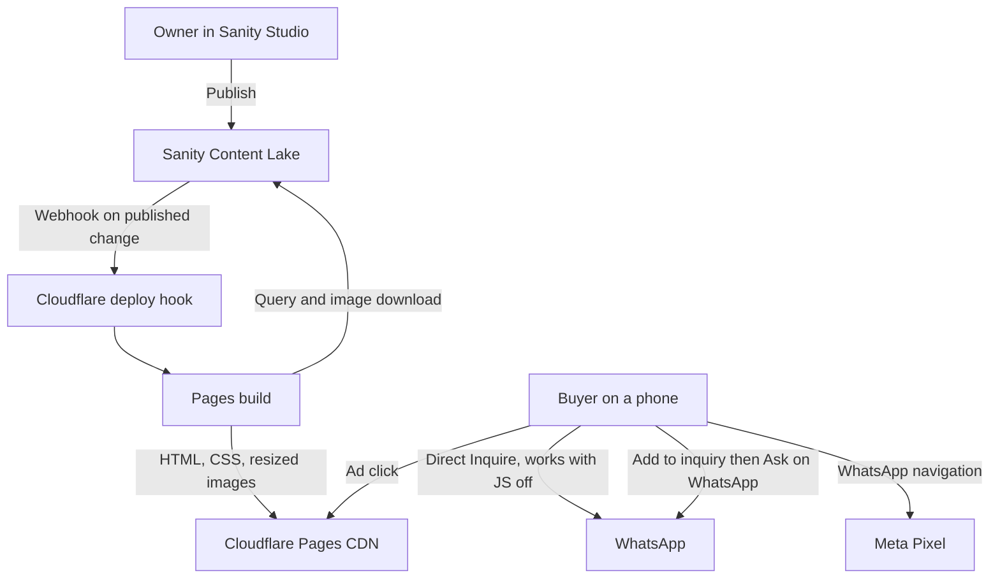

# WhatsApp combo catalog

The business brief in `init-plan.md` still stands. This file is the build plan. Implement from here, in todo order. Do not add a cart, accounts, a database we operate, or React running in the browser.

## Who it is for

Local packaging buyers in Bangladesh arrive from a Facebook or Instagram ad, almost always on a phone. They need a photo, a starting price in BDT, what they get, and the minimum order. The menu lists both **combo packs** (several items sold together) and **single products** (one item, such as mailers or stickers alone). They do not check out on the site. Size, GSM, print, logo files, and final quantity are agreed in WhatsApp.

The owner does not edit HTML, CSS, or JSON. They use a form. Hosting and the content store stay on free tiers. There is no VPS and no monthly server bill.

## Offer types

One catalog, one card layout, one Sanity document type: `offer`.

| `offerType` | Meaning | Included items |
| --- | --- | --- |
| `combo` | A pack (mailers + stickers + cards, etc.) | Required. At least one line. |
| `product` | A single product | Optional. Hide the "Included" block when the list is empty. |

Same WhatsApp button, same Pixel Lead, same sort/hide rules. The type only changes Studio validation, the optional items list, a small badge on the card, and the Lead `content_category`.

## Conversion paths (both on every card)

| Path | What the buyer does | Needs JavaScript |
| --- | --- | --- |
| **A — Direct inquire** | Tap **Inquire on WhatsApp** on one card | No. Real `href` works with JS off. |
| **B — Inquiry list** | Tap **Add to inquiry** on several cards, then **Ask on WhatsApp** on the sticky bar | Yes. List lives in `localStorage`. No server. |

Path B is **not** a checkout cart: no quantities, no payment, no accounts, no stock. It only builds a longer pre-filled WhatsApp message. Path A stays visible and primary.

## Decisions

| Choice | Use | Why |
| --- | --- | --- |
| Public site | Astro 7, static output | The page is a menu. The phone receives HTML and CSS. Astro does not ship a framework runtime. |
| Owner editing | Sanity Studio 6, in `studio/` with its own `package.json` | The form already exists. The Cloudflare build never installs Studio or styled-components. |
| Hosting | Cloudflare Pages | Free static hosting, unlimited static requests, and deploy hooks. Publish in Sanity triggers a rebuild. |
| Images | Downloaded from Sanity and resized by Astro at build time | Served from the Pages domain. One origin on a slow phone, and Sanity's free bandwidth cap is not hit by ad traffic. |
| Catalog UI | React components (`.tsx`) rendered to HTML by Astro at build, modular CSS tokens, and a brand defaults module | Colors, spacing, and type live in one tokens file. Brand name and labels live in one brand module, overridable from Sanity. No hardcoded hex or business name in components. |
| React | `@astrojs/react` for build-time rendering in the site. Studio has its own copy in `studio/`. | No `client:*` directive anywhere, so React never ships to the browser. Interactivity lives in `src/scripts/catalog.ts`. |
| Runtime | Node 24 | Astro 7 and Sanity 6 need Node 22.12 or newer. Node 24 runs the `.ts` test file directly. |
| Tests | `node:test` on the message and URL builders | Those functions are the contract. The page is checked by the manual list in Acceptance. |
| Language | English UI, prices in BDT | Bangla copy is a later content change in Sanity, not a second codebase. |

| Interactivity | Plain TypeScript in `src/scripts/catalog.ts` (+ helpers in `whatsapp.ts`) | Inquiry list, UTM rewrite, highlight, Lead clicks. No React hydration. |
| Inquiry list | `localStorage`, max 12 slugs | Survives a refresh on the same phone. Cleared after the list WhatsApp link is used, or when the buyer clears it. |

Set aside for this project: a React and Vite single-page app (blank screen until JavaScript loads on slow in-app browsers, and the WhatsApp link would depend on it), Next.js, a custom admin on Cloudflare D1 or Workers, Decap or any Git-based CMS (the owner would need GitHub), a Meta Conversions API (it needs a server), a checkout cart with quantities/payments, and order history.

## Free-tier limits that shape the design

| Service | Limit that matters | How the plan stays inside it |
| --- | --- | --- |
| Cloudflare Pages Free | 500 builds a month, one at a time | Only published changes trigger a build. Drafts never do. |
| Sanity Free | 2 GROQ webhooks, 10,000 documents, 250k uncached API requests a month, hard caps | One webhook. One query per build. Images are not served to buyers from Sanity. |
| Meta Pixel | Blocked by some browsers and in-app settings | The WhatsApp link never depends on it. Under-counting is accepted. |

## Out of scope

- Checkout cart, payments, customer accounts, order history, stock
- Quantities on the inquiry list (lines are one per offer; discuss qty on WhatsApp)
- File upload of logos on the website (buyers send files in WhatsApp)
- Per-offer quantity calculator
- Blog, search, and multi-page marketing
- Bangla/English toggle
- Messenger button (WhatsApp is the single conversion)
- Custom domain setup beyond a note in the README (Pages can add one later at no code cost)
- Retargeting audiences and the ad campaign itself (Ads Manager work, after the pixel is live)

## Architecture



At build time, Astro queries published documents, downloads each offer image, and writes HTML plus resized images to `dist`. The browser does not call Sanity. Path A is a normal `https://wa.me/...` link. Path B uses JavaScript to collect offers and open one WhatsApp URL with a multi-line message. When the Pixel ID is set, every WhatsApp navigation also sends a `Lead` event.

If a build fails (Sanity unreachable, missing settings, bad phone number), Cloudflare keeps the last good deployment live. A broken publish never takes the menu down.

## Repository layout

Create these files. Do not add directories that are not listed.

```text
.env.example
.gitignore
.node-version
README.md
astro.config.mjs
package.json
tsconfig.json
public/favicon.svg
public/samples/starter-shop-pack.svg
public/samples/brand-mailer-pack.svg
public/samples/poly-mailers.svg
src/pages/index.astro
src/layouts/Base.astro
src/components/CatalogHeader.tsx
src/components/OfferCard.tsx
src/components/InquiryBar.tsx
src/components/CatalogFooter.tsx
src/components/EmptyMenu.tsx
src/lib/types.ts
src/lib/brand.ts
src/lib/whatsapp.ts
src/lib/whatsapp.test.ts
src/lib/content.ts
src/data/fallback.json
src/scripts/catalog.ts
src/styles/tokens.css
src/styles/global.css
studio/.env.example
studio/package.json
studio/tsconfig.json
studio/sanity.config.ts
studio/sanity.cli.ts
studio/structure.ts
studio/schemaTypes/index.ts
studio/schemaTypes/offer.ts
studio/schemaTypes/siteSettings.ts
```

Untracked: `node_modules/` (root and `studio/`), `dist/`, `.astro/`, `studio/dist/`, `studio/.sanity/`, `.env`, `studio/.env`. Tracked: `.cursor/plans/`, `AGENTS.md`.

### File duties

| File | Duty |
| --- | --- |
| `.node-version` | `24`. Cloudflare Pages reads it for the build. |
| `package.json` | `"type": "module"`, `engines.node` `>=22.12`, scripts below. Dependencies: `astro`, `@astrojs/react`, `react`, `react-dom`, `@sanity/client`, `@sanity/image-url`. Dev dependencies: `@types/react`, `@types/react-dom`. Nothing from Sanity Studio. |
| `astro.config.mjs` | `output: 'static'`. `integrations: [react()]`. `site` from `process.env.PUBLIC_SITE_URL` when set. `image.domains: ['cdn.sanity.io']`. No Cloudflare adapter. |
| `tsconfig.json` | Extends `astro/tsconfigs/strict`. Adds `jsx: "react-jsx"`, `jsxImportSource: "react"`, `allowImportingTsExtensions: true`, and `erasableSyntaxOnly: true` so Node can run `src/lib/*.ts` directly. Excludes `dist` and `studio`. |
| `src/lib/types.ts` | `Offer`, `OfferType`, `SiteSettings`, `Brand`, `UtmParams`, `CatalogContent`, `CardImage`. |
| `src/lib/brand.ts` | Default brand copy and labels, plus `resolveBrand(settings)`. No DOM, no Sanity, no Astro. Components and the page read brand from here, never from string literals. |
| `src/lib/whatsapp.ts` | Pure functions in WhatsApp link contract. No DOM, no Sanity, no Astro imports. Imports types with `import type` from `./types.ts`. |
| `src/lib/whatsapp.test.ts` | The cases in that same section. Imports `./whatsapp.ts` with the extension. |
| `src/lib/content.ts` | `getCatalog()`. Sanity when configured. Local fallback only outside Cloudflare. Calls `resolveBrand` before returning. |
| `src/data/fallback.json` | A complete `CatalogContent`, already in page shape. Local preview only. Mix of combo and product samples. |
| `public/samples/*.svg` | Three 960 by 720 placeholder images for the fallback offers. Flat shapes and the offer name, no external request. |
| `src/layouts/Base.astro` | `html lang="en"`, charset, viewport, title, description, Open Graph tags, CSS tokens and global, optional accent override on `:root`, optional Pixel snippet. |
| `src/pages/index.astro` | Loads the catalog, prepares each card image with `getImage`, composes header, cards or empty state, footer, and the page script. |
| `src/components/CatalogHeader.tsx` | Brand name, headline, subheadline. Props only. No hardcoded copy. |
| `src/components/OfferCard.tsx` | One offer (combo or product). Primary: direct Inquire link. Secondary: Add to inquiry (progressive enhancement). Labels from `Brand`. |
| `src/components/InquiryBar.tsx` | Sticky bar shell: count, Ask on WhatsApp link, Clear. Hidden until JS shows it with items. Rendered without `client:*`. |
| `src/components/CatalogFooter.tsx` | Footer note from `Brand`. |
| `src/components/EmptyMenu.tsx` | Empty-state sentence from `Brand`. |
| `src/scripts/catalog.ts` | `?offer=` highlight, UTM rewrite, inquiry list add/remove/clear/persist, multi-offer WhatsApp href, Lead clicks. |
| `src/styles/tokens.css` | The only place default colors, fonts, spacing, radii, content width, and tap size are defined. CSS custom properties on `:root`. |
| `src/styles/global.css` | Layout and component classes. Uses only `var(--...)` from tokens. No raw hex, no rem sizes invented inline in components. |
| `public/favicon.svg` | Simple mark, no external request. |
| `studio/package.json` | Private package. Dependencies: `sanity`, `react`, `react-dom`, `styled-components`. Scripts `dev` (`sanity dev`), `build` (`sanity build`), `deploy` (`sanity deploy`). |
| `studio/sanity.config.ts` | `projectId` and `dataset` from `process.env.SANITY_STUDIO_PROJECT_ID` and `process.env.SANITY_STUDIO_DATASET`, written out in full so Sanity can replace them. Title "Catalog". Plugin: `structureTool` with `structure.ts`. Singleton rules below. |
| `studio/sanity.cli.ts` | Same `api.projectId` and `api.dataset` for the CLI. |
| `studio/structure.ts` | "Site settings" first, opening document id `siteSettings`. Then "Offers". Filter `siteSettings` out of the generated type list. |
| `studio/schemaTypes/*.ts` | Schemas in Content model. |
| `README.md` | Local setup, deploy, webhook, and the owner steps. |

### Scripts

Root `package.json`:

| Script | Command |
| --- | --- |
| `dev` | `astro dev` |
| `build` | `astro build` |
| `preview` | `astro preview` |
| `test` | `node --test src/lib/whatsapp.test.ts` |
| `studio` | `npm --prefix studio run dev` |
| `studio:deploy` | `npm --prefix studio run deploy` |

Studio dependencies install once with `npm install --prefix studio`. Do not add a root `postinstall` for it, or Cloudflare would install Studio on every build.

Install current majors: Astro 7, Sanity 6, `@sanity/client` 7, `@sanity/image-url` 2. Let npm write the exact versions. Do not hand-write version numbers.

## Content model

Two document types. The public query returns settings plus visible offers.

### `siteSettings`

Document id is always `siteSettings`.

Brand identity the owner edits without a developer. Visual defaults (spacing, fonts, fallback accent) live in `src/styles/tokens.css`. UI label defaults live in `src/lib/brand.ts`. Sanity can override the accent and the labels.

#### Identity

| Field | Type | Rule |
| --- | --- | --- |
| `businessName` | string | Required. Max 80. Header `h1` and part of the page title. |
| `whatsappNumber` | string | Required. After stripping spaces, `+`, `-`, and parentheses, must match `^8801\d{9}$`. Help text: "Bangladesh mobile with country code, for example 8801712345678." |
| `pixelId` | string | Optional. Empty, or `^\d{5,20}$`. Empty means the Pixel snippet is omitted. |
| `headline` | string | Required. Max 120. The line under the business name. |
| `subheadline` | text | Required. Max 280. One short paragraph. |
| `accentColor` | string | Optional. Empty, or `#` plus six hex digits (`^#[0-9A-Fa-f]{6}$`). When set, overrides `--color-accent` at build. When empty, the value in `tokens.css` is used. |

#### Labels (optional overrides)

Each is optional. Empty means use the matching default from `src/lib/brand.ts`. Max 80 unless noted.

| Field | Default in `brand.ts` | Used for |
| --- | --- | --- |
| `pageTitleSuffix` | `Packaging catalog` | Title: `{businessName} · {pageTitleSuffix}` |
| `pricePrefix` | `Starting at` | Price line before the ৳ amount |
| `moqLabel` | `MOQ` | Line before the MOQ value |
| `itemsLabel` | `Included` | List heading on combo cards (and products that list extras) |
| `comboBadge` | `Combo` | Small badge when `offerType` is `combo` |
| `productBadge` | `Product` | Small badge when `offerType` is `product` |
| `inquireLabel` | `Inquire on WhatsApp` | Path A button text |
| `addToInquiryLabel` | `Add to inquiry` | Path B button on each card |
| `inquiryBarTemplate` | `{count} in inquiry` | Sticky bar count; `{count}` replaced at runtime |
| `inquiryAskLabel` | `Ask on WhatsApp` | Sticky bar primary link |
| `inquiryClearLabel` | `Clear` | Sticky bar clear control |
| `inquiryAddedLabel` | `Added` | Brief state on the card button after add (optional, 2s then restore) |
| `inquiryIntro` | `Hi, I am interested in these offers:` | First line of the multi-offer WhatsApp message |
| `inquiryOutro` | `Please share sizes, materials, and the final price for my quantity.` | Last line of the multi-offer message |
| `footerNote` | `Starting prices depend on size, material, print, and quantity. The final price is confirmed on WhatsApp.` | Footer. Max 280. |
| `emptyMenuText` | `Offers will appear here after they are published.` | Empty state. Max 200. |

Studio groups: "Identity" then "Labels". Help text on Labels: "Leave blank to use the site defaults. A developer can change the defaults in src/lib/brand.ts."

Singleton rules in `sanity.config.ts`:

- `document.newDocumentOptions` removes the `siteSettings` template from the global create menu.
- `document.actions` for `siteSettings` keeps only publish, discard changes, and restore. No duplicate, no delete.

### `offer`

| Field | Type | Rule |
| --- | --- | --- |
| `offerType` | string | Required. Radio: `combo` or `product`. Initial value `combo`. |
| `name` | string | Required. Max 80. |
| `slug` | slug | Required. Source `name`, max 96. Sanity's default uniqueness check. This is the `?offer=` value. |
| `startingPrice` | number | Required. Integer. Min 1. Max 10000000. BDT. A starting price, not a checkout price. |
| `moq` | string | Required. Max 40. Example: `300 pcs`. Free text because units vary. |
| `summary` | string | Optional. Max 140. One line such as "For a first order" or "Plain poly mailers". |
| `items` | array of string | Each item max 80. Max 12. **Combo:** required, min 1. **Product:** optional; empty list is allowed. |
| `image` | image | Required. Hotspot on. `alt` string field required, max 140. |
| `whatsappText` | text | Required. Max 500. The pre-filled sentence. The site appends the ad line itself. |
| `sortOrder` | number | Required. Integer. Initial value 0. Lower numbers appear first. Ties break by `name`. |
| `hidden` | boolean | Initial value false. Hidden offers are excluded from the build. |

Studio list title: "Offers". Preview: title `name`, subtitle `{Combo\|Product} · ৳{price} · MOQ {moq}`, media is the image. Order by `sortOrder`. Filter tabs or a simple list is enough; no separate Combos / Products desks.

Initial value for `whatsappText`:

```text
Hi, I am interested in the *{name}*. Please share sizes, materials, and the final price for my quantity.
```

`{name}` is replaced at build time with the offer name. Owners may delete the token and write their own sentence. Replacement runs either way, so a leftover `{name}` never reaches WhatsApp.

The Studio validators duplicate the phone, Pixel, and accent-color regexes. `studio/` is a separate package and does not import from `src/`.

## Brand and design tokens

Two modules own the look and the words. Components do not invent colors or copy.

### `src/styles/tokens.css`

The only default visual source. Define at least:

```css
:root {
  --color-bg: #f7f7f5;
  --color-surface: #ffffff;
  --color-text: #121212;
  --color-text-muted: #5c5c5c;
  --color-border: #e4e4e0;
  --color-accent: #128c7e;
  --color-accent-text: #ffffff;
  --color-focus: #0b5fff;
  --font-family: system-ui, -apple-system, "Segoe UI", Roboto, "Helvetica Neue", Arial, sans-serif;
  --font-size-body: 1rem;
  --font-size-small: 0.875rem;
  --font-size-title: 1.5rem;
  --font-size-price: 1.25rem;
  --line-height: 1.5;
  --space-1: 0.25rem;
  --space-2: 0.5rem;
  --space-3: 0.75rem;
  --space-4: 1rem;
  --space-5: 1.5rem;
  --space-6: 2rem;
  --radius: 0.5rem;
  --content-max: 40rem;
  --tap-min: 44px;
  --highlight-width: 3px;
}
```

`global.css` imports `tokens.css` first and styles with these variables only. Changing the accent for every buyer means editing `--color-accent` here, unless Sanity sets `accentColor`.

### `src/lib/brand.ts`

```ts
export const brandDefaults = {
  pageTitleSuffix: 'Packaging catalog',
  pricePrefix: 'Starting at',
  moqLabel: 'MOQ',
  itemsLabel: 'Included',
  comboBadge: 'Combo',
  productBadge: 'Product',
  inquireLabel: 'Inquire on WhatsApp',
  addToInquiryLabel: 'Add to inquiry',
  inquiryBarTemplate: '{count} in inquiry',
  inquiryAskLabel: 'Ask on WhatsApp',
  inquiryClearLabel: 'Clear',
  inquiryAddedLabel: 'Added',
  inquiryIntro: 'Hi, I am interested in these offers:',
  inquiryOutro:
    'Please share sizes, materials, and the final price for my quantity.',
  footerNote:
    'Starting prices depend on size, material, print, and quantity. The final price is confirmed on WhatsApp.',
  emptyMenuText: 'Offers will appear here after they are published.',
  accentColor: '#128c7e',
} as const

export function resolveBrand(settings: SiteSettings): Brand
export function isAccentColor(value: string): boolean
```

`resolveBrand` copies required identity fields from settings, fills each blank label from `brandDefaults`, and sets `accentColor` to a valid settings value or the token default. `isAccentColor` is `^#[0-9A-Fa-f]{6}$`.

`Brand` includes every label above (same fields as the defaults, plus `businessName`, `headline`, `subheadline`).

Embed brand strings needed by the inquiry script on a root element, for example `#catalog-root` with `data-inquiry-*` attributes for templates and labels, plus `data-whatsapp-number`. Do not hardcode those strings in `catalog.ts`.

### Who changes what

| Change | Edit |
| --- | --- |
| Default colors, spacing, type, content width | `src/styles/tokens.css` |
| Default button text, badges, inquiry copy, footer, empty copy | `src/lib/brand.ts` |
| Live business name, headlines, WhatsApp number, Pixel | Sanity Site settings |
| Live accent color or label overrides for this seller | Sanity Site settings Labels / Identity |
| Layout structure of a card or header | The matching `.tsx` component |

No component may hardcode `#128c7e`, `Northline Packaging`, `Inquire on WhatsApp`, `Add to inquiry`, `Combo`, `Product`, or `Starting at`.

### Client and query

`@sanity/client` config in `content.ts`: `projectId`, `dataset`, `apiVersion: '2026-10-01'`, `useCdn: false`, `perspective: 'published'`, no token. `useCdn: false` because a webhook build starts seconds after a publish, and the API CDN may still return the previous version. One query per build stays well inside the free quota.

```groq
{
  "settings": *[_id == "siteSettings"][0]{
    businessName,
    whatsappNumber,
    pixelId,
    headline,
    subheadline,
    accentColor,
    pageTitleSuffix,
    pricePrefix,
    moqLabel,
    itemsLabel,
    comboBadge,
    productBadge,
    inquireLabel,
    addToInquiryLabel,
    inquiryBarTemplate,
    inquiryAskLabel,
    inquiryClearLabel,
    inquiryAddedLabel,
    inquiryIntro,
    inquiryOutro,
    footerNote,
    emptyMenuText
  },
  "offers": *[_type == "offer" && hidden != true && defined(image.asset)] | order(sortOrder asc, name asc) {
    offerType,
    name,
    "slug": slug.current,
    startingPrice,
    moq,
    summary,
    items,
    whatsappText,
    image { alt, hotspot, crop, asset }
  }
}
```

`hotspot` and `crop` must be in the projection, or the image builder ignores the owner's focal point.

Build image URLs with `createImageUrlBuilder` from `@sanity/image-url`:

- Card source: width 960, height 720, fit `crop`, format `jpg`, quality 85. Astro resizes from this source.
- Share image: width 1200, height 630, fit `crop`, format `jpg`, quality 80. Used for `og:image` only.

### Fetch rules

`getCatalog()` reads each variable from `import.meta.env` first, then `process.env`. Local values come from `.env`. Cloudflare values come from the build environment.

1. If `SANITY_PROJECT_ID` and `SANITY_DATASET` are set, query Sanity. If `settings` is null, fail the build with "Publish the Site settings document in Sanity."
2. If those variables are missing and `CF_PAGES` is not `1`, return `src/data/fallback.json`.
3. If those variables are missing and `CF_PAGES` is `1`, fail the build with "Set SANITY_PROJECT_ID and SANITY_DATASET in Cloudflare Pages."
4. Normalize `settings.whatsappNumber`. If it is invalid, fail the build with "Fix the WhatsApp number in Site settings."
5. If `settings.pixelId` is set but invalid, warn and treat it as empty.
6. If `settings.accentColor` is set but invalid, warn and treat it as empty so `resolveBrand` uses the token default.
7. Skip an offer, with a warning that names it, when its slug is blank, its price is not a positive integer, `offerType` is not `combo` or `product`, `whatsappText` is blank, its image has no `alt`, or (`offerType` is `combo` and `items` is empty). Studio validation should make this rare.

`CF_PAGES` is `1` on every Cloudflare Pages build, production and preview.

`getCatalog()` returns plain data, including a resolved `brand`. Pages never import the Sanity client.

```ts
type OfferType = 'combo' | 'product'

type Offer = {
  offerType: OfferType
  name: string
  slug: string
  startingPrice: number
  moq: string
  summary?: string
  items: string[]
  whatsappText: string
  imageUrl: string
  imageAlt: string
}

type SiteSettings = {
  businessName: string
  whatsappNumber: string
  pixelId?: string
  headline: string
  subheadline: string
  accentColor?: string
  pageTitleSuffix?: string
  pricePrefix?: string
  moqLabel?: string
  itemsLabel?: string
  comboBadge?: string
  productBadge?: string
  inquireLabel?: string
  addToInquiryLabel?: string
  inquiryBarTemplate?: string
  inquiryAskLabel?: string
  inquiryClearLabel?: string
  inquiryAddedLabel?: string
  inquiryIntro?: string
  inquiryOutro?: string
  footerNote?: string
  emptyMenuText?: string
}

type CatalogContent = {
  settings: SiteSettings
  brand: Brand
  offers: Offer[]
  shareImageUrl?: string
}
```

`whatsappNumber` is already normalized. `brand` is the output of `resolveBrand(settings)`. `items` is always an array (possibly empty for products). `imageUrl` is the 960 by 720 Sanity source URL, or `/samples/{slug}.svg` in the fallback. `shareImageUrl` is the share image of the first offer, absent in the fallback.

## WhatsApp link contract

All of this lives in `src/lib/whatsapp.ts`.

```ts
function applyNameToken(whatsappText: string, name: string): string

function composeInquiryText(whatsappText: string, name: string, utm: UtmParams): string

function composeInquiryListText(
  lines: InquiryLine[],
  intro: string,
  outro: string,
  utm: UtmParams,
): string

function normalizeWhatsAppNumber(number: string): string

function buildWhatsAppUrl(number: string, text: string): string
```

```ts
type UtmParams = {
  source?: string
  campaign?: string
  content?: string
}

type InquiryLine = {
  name: string
  offerType: OfferType
  startingPrice: number
  moq: string
  typeLabel: string
  pricePrefix: string
  moqLabel: string
}
```

`applyNameToken` replaces every `{name}` with the offer name.

`composeInquiryText` runs `applyNameToken`, trims, then appends an ad line only when at least one UTM value is non-empty after trim:

```text
{message}

Ad: {source} / {campaign} / {content}
```

Skip empty parts and do not leave a dangling separator.

| Inputs | Ad line |
| --- | --- |
| no utm | omitted |
| source `facebook` | `Ad: facebook` |
| source `facebook`, content `carousel-starter` | `Ad: facebook / carousel-starter` |
| source, campaign, and content | `Ad: facebook / mailers / carousel-starter` |

`composeInquiryListText` builds Path B. Format prices with the same `en-IN` grouping as the cards. Example body:

```text
Hi, I am interested in these offers:

1. *Starter Shop Pack* (Combo) — Starting at ৳2,500 — MOQ 300 pcs
2. *Poly Mailers* (Product) — Starting at ৳1,200 — MOQ 500 pcs

Please share sizes, materials, and the final price for my quantity.
```

Then append the same `Ad:` line rules as `composeInquiryText`. Reject an empty `lines` array with a thrown error. Cap at 12 lines (callers must not pass more).

The buyer sees the message before sending. Name campaigns and ads in Ads Manager with words you are happy for a buyer to read.

`normalizeWhatsAppNumber` strips spaces, `+`, `-`, and parentheses. The result must match `^8801\d{9}$`. Otherwise it throws. It runs once, on the settings number, in `content.ts`.

`buildWhatsAppUrl` returns `https://wa.me/{digits}?text={encodeURIComponent(text)}`. Build the query string by hand. `URLSearchParams` would encode spaces as `+`.

### Build-time and run-time links (Path A)

The page cannot read `utm_*` at build time.

- At build, `OfferCard.tsx` sets the Inquire `href` to `buildWhatsAppUrl(number, composeInquiryText(whatsappText, name, {}))`. A visit without JavaScript opens the right offer with no ad line.
- At load, `catalog.ts` reads `utm_source`, `utm_campaign`, and `utm_content`. When at least one is present, it rewrites every `[data-whatsapp]` Inquire href with `buildWhatsAppUrl(link.dataset.whatsappNumber, composeInquiryText(link.dataset.whatsappText, link.dataset.comboName, utm))`.

### Inquiry list (Path B)

Storage key: `packaging-inquiry-slugs`. Value: JSON array of slugs, max 12, unique, order = add order.

Each offer card exposes data for the script (on the article or the Add button): `data-offer`, `data-combo-name`, `data-offer-type`, `data-combo-price`, `data-moq`, and the resolved type badge text.

`catalog.ts`:

1. On load, read storage, drop slugs that are not on the page, show or hide `#inquiry-bar`.
2. **Add to inquiry** (`[data-add-inquiry]`): append slug if under 12 and not already present; update bar; briefly set the button label to `inquiryAddedLabel`.
3. **Clear**: empty storage and hide the bar.
4. **Ask on WhatsApp** (`[data-inquiry-whatsapp]`): build `composeInquiryListText` from the cards still on the page for those slugs, set `href`, fire Lead, navigate. After click starts navigation, clear the list (or clear on `pagehide`).
5. Without JS: hide Add buttons and the bar with the `hidden` attribute in HTML; `catalog.ts` reveals Add buttons on load. Path A Inquire stays visible always.

`catalog.ts` imports `whatsapp.ts`. Do not copy the message rules into the script.

### Tests

Cover at least:

- `{name}` replacement, including two occurrences
- Custom text with no token is unchanged
- No ad line when every UTM value is missing or blank
- Single present UTM value, and a gap in the middle (`source` and `content` only)
- `composeInquiryListText` with two lines, intro, outro, and optional Ad line
- `composeInquiryListText` throws on empty lines
- `+880 1712-345678` and `(880) 1712 345678` normalize to `8801712345678`
- Reject `01712345678`, `880171234567`, and `8802123456789`
- URL host is `wa.me`, path is the digits, the text decodes back exactly, and a space is `%20`, not `+`
- A Bangla sentence and an emoji round-trip through the URL

## Meta Pixel contract

In `Base.astro`, when `pixelId` is set, build the standard Meta base code as a string in the frontmatter, with that id, and render it with `<script is:inline set:html={pixelCode}></script>`. Add the matching `<noscript>` image tag. Interpolation is safe because `content.ts` already reduced the id to digits. Do not use `define:vars` for this snippet. Otherwise omit it and do not load `connect.facebook.net`.

`catalog.ts` listens for clicks on `[data-lead]`. It does not call `preventDefault`. The anchor's `href` opens WhatsApp. Do not add `target="_blank"`.

When `window.fbq` is a function, call:

**Path A (single Inquire):**

```js
fbq('track', 'Lead', {
  content_name: name,
  content_category: offerType === 'product' ? 'packaging-product' : 'packaging-combo',
  currency: 'BDT',
  value: price,
})
```

**Path B (inquiry list Ask):**

```js
fbq('track', 'Lead', {
  content_name: names.join(', ').slice(0, 100),
  content_category: 'packaging-inquiry',
  currency: 'BDT',
  value: totalStartingPrices,
  num_items: names.length,
})
```

`name` / `names` come from the card data attributes. `value` for Path A is one starting price; for Path B it is the sum of starting prices on the list (still not a checkout total). A blocked pixel or a missing `fbq` still follows the link. No timeout before navigation. Adding to the inquiry list does **not** fire Lead — only WhatsApp navigation does. A Conversions API is out of scope because it needs a server.

## Page behavior

One route, `/`.

`index.astro` loads `getCatalog()`, builds `CardImage` values, and renders:

```tsx
<div id="catalog-root" data-whatsapp-number={...} data-inquiry-...={brand fields}>
  <CatalogHeader brand={brand} />
  {offers.length === 0 ? (
    <EmptyMenu text={brand.emptyMenuText} />
  ) : (
    offers.map((offer, i) => (
      <OfferCard
        key={offer.slug}
        offer={offer}
        image={images[i]}
        brand={brand}
        whatsappNumber={settings.whatsappNumber}
        isFirst={i === 0}
      />
    ))
  )}
  <InquiryBar brand={brand} whatsappNumber={settings.whatsappNumber} />
  <CatalogFooter note={brand.footerNote} />
</div>
```

Every React component is rendered without a `client:*` directive. No hooks, no event handlers, no browser APIs in `src/components/`.

### Header (`CatalogHeader`)

- `brand.businessName` as the `h1`
- `brand.headline`
- `brand.subheadline`

### Cards (`OfferCard`)

Single column, content width `var(--content-max)`, on every viewport. Ad traffic is a phone. A multi-column grid hides the button. Combos and products share this layout.

Each card, top to bottom:

1. Image, 4:3, `alt` from the CMS
2. Badge: `brand.comboBadge` or `brand.productBadge` from `offer.offerType`
3. Offer name (`h2`)
4. Price line: `{brand.pricePrefix} ৳{amount}`. Format the amount with `Intl.NumberFormat('en-IN', { maximumFractionDigits: 0 })`, which gives Bangladesh grouping such as `৳1,00,000`.
5. `{brand.moqLabel} {moq}`
6. Summary, only when it has text
7. A list labelled `{brand.itemsLabel}` with one row per item — **omit this whole block when `items.length === 0`** (typical for a bare product)
8. Actions column (stacked, full width):
   - Primary link: `{brand.inquireLabel}` — Path A, min height `var(--tap-min)`, `data-whatsapp` + `data-lead`
   - Secondary control: `{brand.addToInquiryLabel}` — Path B, `type="button"`, `data-add-inquiry`, `hidden` until JS reveals it, min height `var(--tap-min)`

Images:

Astro's `<Image>` cannot be used inside a React component. `index.astro` prepares the image and passes plain values to `OfferCard`:

```ts
type CardImage = {
  src: string
  srcSet?: string
  sizes?: string
  width: number
  height: number
  alt: string
}
```

- For a Sanity URL, call `getImage` from `astro:assets` with `src: imageUrl`, `width: 960`, `height: 720`, `widths: [480, 720, 960]`, `format: 'webp'`, `quality: 70`. Pass its `src` and `srcSet.attribute`, with `sizes` `"(max-width: 40rem) 100vw, 40rem"`. Astro downloads the source at build and writes the resized files to `dist/_astro`.
- For a fallback path that starts with `/`, pass the path as `src` with no `srcSet`.
- `OfferCard` renders a plain `` with those values. The first card gets `loading="eager"` and `fetchPriority="high"`. The rest get `loading="lazy"`.

`OfferCard` props: `offer: Offer`, `image: CardImage`, `brand: Brand`, `whatsappNumber: string`, `isFirst: boolean`. It formats the price and builds the Path A `href` itself, importing `whatsapp.ts`.

The card root is an `article` with `id="offer-{slug}"` and `data-offer="{slug}"`. The Inquire link has:

- `href` as in Build-time and run-time links (Path A)
- `data-whatsapp`
- `data-lead`
- `data-combo-name` (offer title)
- `data-combo-price`
- `data-offer-type` (`combo` or `product`)
- `data-whatsapp-number`, the normalized number
- `data-whatsapp-text`, the stored `whatsappText` with `{name}` already replaced and no ad line

The Add button carries the same offer identity attributes needed to build a list line (`data-offer`, name, type, price, moq, type badge label).

### Inquiry bar (`InquiryBar`)

Fixed to the bottom of the viewport when visible. Content:

- Count text from `inquiryBarTemplate` with `{count}`
- Link `{brand.inquiryAskLabel}` with `data-inquiry-whatsapp` and `data-lead` (href filled by JS)
- Button `{brand.inquiryClearLabel}`

Root has `id="inquiry-bar"` and `hidden` by default. Leave bottom padding on the page so the last card is not covered when the bar is open. Use tokens for colors; no raw hex.

### `?offer=` highlight

On load, read `offer` from the query string; if missing, also accept `combo` as an alias (same slug). If it matches a `[data-offer]` value, scroll that card into view and set `data-highlight="true"`. Unknown values show the full menu with nothing highlighted. The highlight uses `var(--color-accent)` and `var(--highlight-width)`. Scroll with `behavior: 'auto'` when `prefers-reduced-motion: reduce` matches, otherwise `smooth`.

### Empty menu (`EmptyMenu`)

If there are zero offers, render the header and `brand.emptyMenuText`. Do not render Inquire, Add, or the inquiry bar without an offer.

### Footer (`CatalogFooter`)

`brand.footerNote`.

### Visual rules

- Import order in `Base.astro`: `tokens.css`, then `global.css`.
- When `brand.accentColor` differs from the token default, set `style={`--color-accent:${brand.accentColor}`}` on `<html>` or `<body>` so one publish can rebrand the button and highlight. Do not rewrite `tokens.css` at build.
- Components and `global.css` use only CSS variables. No raw hex in `.tsx` or in `global.css`.
- System font stack from `--font-family`. No web fonts.
- Button stretches to the card width, color `var(--color-accent)`, label `var(--color-accent-text)`.
- Price is the strongest text on the card after the name (`--font-size-price`).
- No carousel, modal, or animation library.
- Focus states use `var(--color-focus)` and stay visible.
- Close every HTML element. Astro 7's compiler rejects unclosed tags.
- In `.tsx`, use `className`. `data-*` attributes keep their HTML names.

### Head metadata

- Title: `{brand.businessName} · {brand.pageTitleSuffix}`
- Meta description: `brand.subheadline`
- `og:title`, `og:description`, and `og:type` `website`
- `og:image`: `shareImageUrl` when present
- `og:url` and `<link rel="canonical">`: `PUBLIC_SITE_URL` when set

## Environment

Root `.env.example`, read by the Astro build:

```text
SANITY_PROJECT_ID=
SANITY_DATASET=production
PUBLIC_SITE_URL=
```

`studio/.env.example`, read by the Sanity CLI:

```text
SANITY_STUDIO_PROJECT_ID=
SANITY_STUDIO_DATASET=production
```

Both hold the same project id and dataset. Neither is a secret, since the dataset is public, but `.env` files stay untracked.

`PUBLIC_SITE_URL` is the canonical Pages URL with no trailing slash. The WhatsApp number and Pixel ID are content, not env vars, so the owner changes them without a developer.

Never commit a Cloudflare deploy hook URL. It lives only in the Sanity webhook settings.

## Deploy

### Sanity

1. Create a project and a public dataset named `production`.
2. Fill both `.env` files.
3. `npm install --prefix studio`, then `npm run studio`. Sign in at `http://localhost:3333`. Create and publish Site settings and at least one offer.
4. `npm run studio:deploy`. Choose a hostname when asked and commit any config the CLI asks you to add.
5. Invite the owner to the project at the Administrator role. The Free plan has Administrator and Viewer only.

The deployed Studio on `*.sanity.studio` needs no CORS entry. Local Studio needs `http://localhost:3333` with credentials allowed, which the CLI offers to add. The Pages site queries Sanity from the build server, so it needs no CORS entry.

### Cloudflare Pages

- Connect the GitHub repository. Production branch `main`.
- Framework preset: Astro. Build command `npm run build`. Output directory `dist`.
- Node comes from `.node-version`.
- Environment variables for both Production and Preview: `SANITY_PROJECT_ID`, `SANITY_DATASET`, and `PUBLIC_SITE_URL` once the Pages URL is known. A preview build without them fails by design.
- Build watch paths: exclude `studio/**`, `.cursor/**`, and `*.md`, so Studio and doc commits do not use builds. Deploy hooks still build.
- Settings, Builds, Deploy hooks: create one hook for `main`.

### Webhook

In Sanity, API, Webhooks, create one webhook:

| Setting | Value |
| --- | --- |
| URL | The Cloudflare deploy hook |
| Dataset | `production` |
| Trigger on | Create, Update, Delete |
| Filter | `_type in ["offer", "siteSettings"]` |
| Projection | empty |
| Drafts | Off |
| Versions | Off |
| Method | POST |

Drafts must stay off. Studio saves a draft on almost every keystroke, and each one would start a build.

Each publish starts one build. Publishing five offers one after another queues five builds, and the last one wins. The free plan allows 500 a month. The live page updates when the build finishes, usually within a couple of minutes.

## Sample content

Put this in `fallback.json`. It is local preview data and must not reach production.

Settings: business name `Northline Packaging`, WhatsApp number `8801000000000`, pixel id empty, accent and all label fields empty (so `resolveBrand` uses `brand.ts` / `tokens.css` defaults), headline `Packaging for your shop`, subheadline `Browse combo packs and single products, then message us on WhatsApp. We will confirm size, print, and the final price.`

`8801000000000` passes validation and belongs to no operator, so a local test tap cannot message a stranger.

| Type | Name | Slug | Price | MOQ | Summary | Items |
| --- | --- | --- | --- | --- | --- | --- |
| combo | Starter Shop Pack | `starter-shop-pack` | 2500 | 300 pcs | For a first order | Poly mailers, Thank-you cards, Round stickers |
| combo | Brand Mailer Pack | `brand-mailer-pack` | 6500 | 500 pcs | For shops that print their logo | Printed mailers, Tissue paper, Logo stickers, Thank-you cards |
| product | Poly Mailers | `poly-mailers` | 1200 | 500 pcs | Plain mailers, no print | _(empty)_ |

Each `whatsappText` is the default sentence with `{name}` already replaced. `imageUrl` is `/samples/{slug}.svg`. `imageAlt` describes the placeholder. Order is as listed.

## README contents

For the person setting the project up, then for the owner. Keep it short.

1. What the site does, in four lines
2. Node 24, `npm install`, copy `.env.example` to `.env`, `npm run dev` (works on sample data)
3. Create the Sanity project, fill both `.env` files, install and run Studio
4. Deploy Studio and invite the owner
5. Cloudflare Pages settings, environment variables, and the webhook table
6. Owner steps: open Studio, create an Offer, choose Combo or Product, set the photo and its hotspot, press Publish, wait for the build, check the live card and the WhatsApp message
7. Hide an offer with `hidden`, reorder with `sortOrder`, change the number, Pixel ID, accent color, or labels in Site settings
8. Change the default look in `src/styles/tokens.css` and the default words in `src/lib/brand.ts`. Publish Site settings only when the live seller needs different copy or accent.
9. Publish when an edit is finished. Drafts do not change the live page.
10. Ad links: `/?offer={slug}&utm_source=facebook&utm_campaign={{campaign.name}}&utm_content={{ad.name}}` (`?combo=` also works as an alias for the slug highlight)

## Acceptance

The implementation is done when all of these are true:

1. `npm test` passes on Node 24.
2. `npm run build` with no Sanity env vars succeeds off Cloudflare, and `npm run preview` shows the three sample offers (two combos, one product) with their placeholder images.
3. The same build with `CF_PAGES=1` and no Sanity env vars fails with the message in Fetch rules.
4. With a real dataset, published settings and offers are what the page shows. A hidden offer is absent. Order follows `sortOrder`. Product cards without items omit the Included block. Combo cards require items.
5. Each Path A button opens `wa.me` with the single-offer sentence. With UTM params in the page URL, the pre-filled chat includes the `Ad:` line after JavaScript runs.
6. With JavaScript on, Add to inquiry collects up to 12 offers; the sticky bar Ask on WhatsApp opens one chat listing those offers (intro, numbered lines, outro, optional Ad line). Clear empties the list. Without JavaScript, Add and the bar stay hidden; Path A still works.
7. `/?offer=brand-mailer-pack` and `/?combo=brand-mailer-pack` both scroll to that card and highlight it. A bad slug does not break the page.
8. With a Pixel ID saved, Path A Lead uses `packaging-combo` or `packaging-product`; Path B Lead uses `packaging-inquiry`. Adding to the list does not fire Lead. With the Pixel ID empty, the page does not request `connect.facebook.net`.
9. With JavaScript disabled, the Path A WhatsApp link still opens the offer message, without the ad line.
10. Offer images load from the Pages domain, not `cdn.sanity.io`.
11. The owner can change the phone number, a price, and a photo in Studio and, after the webhook build, see those changes live without a code edit.
12. Typing in Studio without publishing does not start a Cloudflare build. Publishing starts exactly one.
13. The root `npm install` does not install `sanity`.
14. The built page loads no React: no `astro-island` element and no `react-dom` chunk in `dist/_astro`.
15. `global.css` and every `.tsx` file contain no raw hex colors and no hardcoded brand strings listed in Brand and design tokens.
16. Changing `--color-accent` in `tokens.css` changes the button and highlight after a rebuild. Setting a valid `accentColor` in Site settings overrides it on the next publish build.
17. The page's own HTML, CSS, and JavaScript stay under 50 KB gzipped, excluding images and the Meta script (raised from 40 KB to allow the inquiry script).

## Implementation order

Follow the todos. Do not start the page before `whatsapp.ts` and its tests exist. Do not point Cloudflare at the repository until a local production build has succeeded against Sanity.
